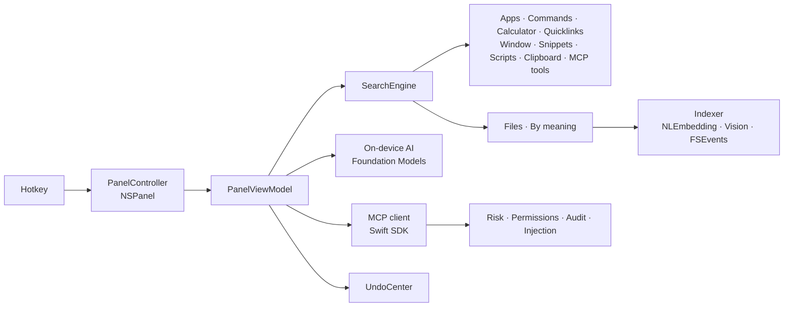

# Glink

**The private, secure AI launcher for Mac.**

Press **⌥ Space**, type a few letters, and launch apps, find files by name *or by meaning*, do math, reuse your clipboard, snap windows, expand snippets, ask on-device AI, and run MCP tools safely. Everything runs on your Mac: no API keys, no cloud, no analytics.

> Swift 6 · SwiftUI + AppKit · SwiftData · Apple Foundation Models · NaturalLanguage · Vision · MCP Swift SDK

<!-- GIFs: record with `Glink --open "query"`, `--route clipboard|mcp`, `--ask "question"`, `--demo-permission`, `--mascot` -->
| | |
|---|---|
|  |  |
| *Launcher: apps, files, calculator* | *On-device AI, streamed* |
|  |  |
| *Check MCP Security: A–F grades* | *Permission before any write* |
|  |  |
| *Prompt-injection warning* | *“invoice from september” → scan_0042.pdf* |
|  |  |
| *⌘Z undo with countdown* | *A kitten or puppy now and then* |

## Features

**Launcher**
- Fuzzy app search, Spotlight file search, a calculator with unit conversion, and ⌘K actions.
- Clipboard history with image previews, window snapping with a preview overlay, snippets, quicklinks, and script commands.
- Floating notes, menu bar mini mode, onboarding, and a full Settings window.

**On-device AI** (Apple Foundation Models)
- Ask AI, or type the question inline: "ask what is a closure in swift".
- Rewrite selected text: more professional, shorter, or fix grammar.
- Summarize the clipboard, or explain a selection.
- Responses stream word by word with a caret and an **On-device · Private** badge.
- On Macs that can't run the model, the commands are hidden and an inline card explains why.

**Safe MCP**
- **Check MCP Security** scans Claude Desktop, Claude Code, Cursor, VS Code, Windsurf, Zed, Gemini CLI and Continue configs.
  - It uses Tollgate's rules engine plus Glink's own rules, giving each server an A–F grade with a fix for every finding.
  - Secrets are masked to their first 4 characters.
- **MCP client.** Connect stdio servers in Settings; their tools become commands, with forms generated from each tool's JSON schema.
  - A server must pass the security check before it can be enabled. Grade D or F needs your confirmation.
- **Permissions.** Tools are classified as read-only, network, writes, deletes, or runs commands.
  - Anything that isn't read-only shows the exact arguments first: **Allow once / Always allow / Deny**.
  - Denied calls never reach the server.
- **MCP Activity:** every call is audited (secrets masked), searchable, filterable by `server:name`, and exportable as JSON.
- **Prompt-injection detection** on every tool result, in two layers:
  - fast pattern rules
  - an on-device model check for flagged results and untrusted servers

  Flagged results show a warning with the suspicious text highlighted, and never reach the AI without your OK.

**Search by meaning**
- Indexes text, Markdown, PDFs (scans via Vision OCR), Word, RTF and screenshots in folders you choose.
- Uses on-device NaturalLanguage embeddings with hybrid ranking, so exact name matches still win.
- Watches the folders for changes, and pauses while you type or on low battery.

**Context-aware suggestions**
- The empty search field shows **Suggested** items, each with a reason: "You usually open this around 10 am", "Often used with Xcode".

**Undo & previews**
- ⌘Z undoes window snaps, files moved to Trash, clipboard changes, snippet expansions and AI rewrites, with a 5-second undo toast.
- **Recent Actions** lists the last 20.
- Destructive actions preview exactly what will change.

**Playful touches**
- Now and then a kitten 🐱, a puppy 🐶 or a trending friend (🦫 🦦 🦆 🐸 🐹 🐼) peeks out to celebrate.
- Seasonal guests visit too: 👻 🎃 at Halloween, 🪔 at Diwali, ❄️ in December.
- They never block input, skip Reduce Motion, and can be turned off in Settings › Appearance.

## System requirements

| Feature | Needs |
|---|---|
| Glink | macOS 14 Sonoma or later |
| On-device AI and the AI layer of injection detection | macOS 26, Apple silicon, Apple Intelligence turned on |
| MCP servers via `npx` / `uvx` | Node.js / uv installed (Homebrew paths are picked up automatically) |

## Install (free release)

1. Download `Glink.zip` from [Releases](https://github.com/SaiPranav13188/Glink/releases) and unzip it.
2. Move **Glink.app** to **Applications** and open it.
3. macOS will say it can't verify the developer, because free builds aren't notarized. Click **Done**, then open **System Settings → Privacy & Security** and click **Open Anyway** next to the Glink message. Confirm with **Open**.
4. Follow the welcome tour. Press **⌥ Space** anytime.

## Permissions (and why)

| Permission | Why | When it's asked |
|---|---|---|
| **Accessibility** | Snapping windows, pasting into the frontmost app, reading selected text for AI, snippet expansion (keystrokes stay in memory and are never logged) | When you first use one of those features |
| **Files & Folders** (Documents, Desktop, Downloads) | Search by meaning reads the folders you pick | Only after you turn on search by meaning |
| **Automation → System Events** | Only the "Toggle System Appearance" command | When you run it |

Every permission is optional; features that need one explain why and offer a button.

## Privacy

- **AI** runs on-device with Apple's Foundation Models. Nothing you ask or select is sent anywhere.
- **The search index, clipboard history, snippets, usage data and the MCP audit log** live in `~/Library/Application Support/Glink`. Clear or pause them in Settings.
- **MCP:** Glink starts only the servers you enable, shows every non-read-only call before it runs, and logs calls with secrets masked.
- **No analytics, no telemetry.** The only network traffic is what your own MCP servers and quicklinks do, plus update checks for notarized builds.

## Architecture



The pure logic (fuzzy matching, calculator, MCP rules, injection detection, risk classification, forms, chunking and vector ranking, suggestion scoring, the undo log) lives in `GlinkCore` and is unit-tested. See [docs/ARCHITECTURE.md](docs/ARCHITECTURE.md) for the full map.

## Quality

**Injection detection, layer 1** (`swift test`, labelled set in `Tests/GlinkCoreTests/Fixtures/injection`):

| Samples | Detection rate | False-positive rate |
|---|---|---|
| 30 (15 injected, 15 clean) | **100%** (15/15) | **0%** (0/15) |

The set covers overrides, role changes, system-prompt probing, hidden HTML comments, exfiltration URLs, tool-call requests, secrecy requests, credential requests, fake chat markers, invisible Unicode tags, zero-width characters and base64 payloads. The clean samples include near-misses: security docs, prompt-writing tips, HTML comments and long hashes. The rules were tuned on this set, so treat it as a regression suite. A held-out set is the next step for an unbiased number.

**Tests:**
- `swift test`: 71 Glink tests (AI engine with a mock model, MCP rules per fixture, risk classifier, permissions, forms, injection, chunking and ranking, suggestions, undo, calculator, fuzzy matcher).
- `cd Packages/MCPShieldCore && swift test`: Tollgate's 45 tests, including its precision/recall eval.
- Xcode UI tests drive the real panel and run `performAccessibilityAudit()` on four panel states.

**Performance** (release build, `Glink --ephemeral --benchmark`):

| Metric | Measured |
|---|---|
| Panel open | ~12 ms |
| Keystroke → results | < 2 ms |
| Search 10,000 chunks by meaning | ~40 ms |
| Idle memory | ~26 MB |
| Idle CPU | 0% |

**Self-tests:**
- `Glink --ephemeral --mcp-selftest` connects to the real filesystem MCP server, checks tool risks and permissions, and plants an injection.
- `Glink --ephemeral --semantic-selftest` indexes a scanned invoice PDF and a screenshot, then searches for them by meaning.

## Build from source

```sh
scripts/build-app.sh      # → build/Glink.app (ad-hoc signed)
swift test                # unit tests
scripts/release.sh        # tests + universal build → build/Glink.zip for a GitHub Release
```

For Xcode, run `brew install xcodegen && xcodegen generate && open Glink.xcodeproj`.

For notarized builds with Sparkle auto-updates (requires the $99/year Apple Developer Program), see `scripts/make-dmg.sh`.

## Keyboard

| Key | Action |
|---|---|
| ⌥ Space | Toggle Glink |
| ↑ ↓ | Move selection |
| ↵ | Run |
| ⌘K | Actions |
| ⌘1–9 | Run result 1–9 |
| Tab | Enter a command's argument / autocomplete |
| Esc | Clear → back → close |
| ⌘Z (empty field) | Undo Glink's last action |
| ⌘, | Settings |

---

Built by B. Sai Pranav. MCP security rules from [Tollgate](https://github.com/SaiPranav13188/Tollgate).
